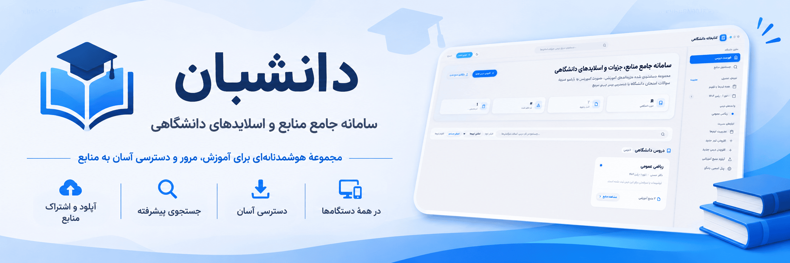

# Daneshban — University Library Management System

A web-based system built on Python and Django framework for managing, categorizing, and easy access to university lecture notes, slides, exercises, exam samples, and academic references. This project is fully right-to-left (RTL), uses the self-hosted Vazirmatn font (offline-capable), and features Persian (Jalali) calendar with Persian numerals.

---

### Table of Contents
1. [Key Features](#key-features)
2. [Prerequisites](#prerequisites)
3. [Install & Run with Docker (Recommended)](#install--run-with-docker-recommended)
4. [Local Development (Clone & Run from Source)](#local-development-clone--run-from-source)
5. [Creating Admin User (Superuser)](#creating-admin-user-superuser)
6. [Seed Demo Data](#seed-demo-data)
7. [Adding Courses & Files](#adding-courses--files)
8. [Changing the Font](#changing-the-font)
9. [Backup & Restore](#backup--restore)
10. [Production Deployment Notes](#production-deployment-notes)
11. [Running Tests](#running-tests)

---

### Key Features
- **Fully Persian & RTL:** Built with modern logical CSS properties (`margin-inline`, `padding-inline`, etc.) — no external CDN dependencies.
- **Self-hosted Vazirmatn Font:** Official woff2 files in `static/fonts/` — 100% offline operation.
- **Jalali (Persian) Calendar:** All upload dates converted to Persian calendar with Persian numerals (۰۱۲۳۴۵۶۷۸۹) via `jdatetime`.
- **Auto-categorization by file type:** Notes, slides, exercises, exam samples, books, and others.
- **Advanced search & semester filter:** Search in file title, course name, professor, topics, and tags.
- **Standard Persian filename downloads:** Full RFC 5987 support (`filename*=UTF-8''...`).
- **Upload validation:** Size limit (default 100MB) and allowed extensions (PDF, Office, archives, images, text).
- **Django Admin Panel:** Fully Persian/RTL for granular system management.
- **Docker Support:** Pre-built images on GitHub Container Registry.

---

### Prerequisites
- **For Docker:** Docker Engine 24+ and Docker Compose v2+
- **For local development:** Python 3.11+, `python3-venv`

---

### Install & Run with Docker (Recommended)

This method uses pre-built images from **GitHub Container Registry** — no need to clone the repo or build locally.

#### 1. Prerequisites
```bash
# Docker and Docker Compose installed
docker --version
docker compose version
```

#### 2. Get Configuration Files
```bash
# Download .env.example and docker-compose.yml
curl -O https://raw.githubusercontent.com/amirrezesf/Daneshban/main/.env.example
curl -O https://raw.githubusercontent.com/amirrezesf/Daneshban/main/docker-compose.yml

# Rename and edit .env
mv .env.example .env
# Set SECRET_KEY, ALLOWED_HOSTS, and other variables in .env
```

#### 3. Run with Docker Compose (Recommended)
```bash
# Start services (image pulled from ghcr.io)
docker compose up -d
```

#### 4. Run Standalone Container (without docker-compose)
```bash
# Pull latest image
docker pull ghcr.io/amirrezesf/daneshban:latest

# Run
docker run -d \
  --name daneshban \
  -p 2445:2445 \
  -e SECRET_KEY="your-secret-key" \
  -e DEBUG=False \
  -e ALLOWED_HOSTS="*" \
  -v $(pwd)/media:/app/media \
  -v $(pwd)/staticfiles:/app/staticfiles \
  ghcr.io/amirrezesf/daneshban:latest
```

#### 5. Access the System
Open browser to `http://localhost:2445`

> **Note:** For Production, always set environment variables in `.env` and use `DEBUG=False`. Generate a secure random SECRET_KEY.

---

### Local Development (Clone & Run from Source)

This method is for contributing to the codebase or customizing the application.

```bash
# 1. Clone repository
git clone https://github.com/amirrezesf/Daneshban.git
cd Daneshban

# 2. Create virtual environment
python3 -m venv .venv
source .venv/bin/activate

# 3. Install dependencies
pip install -r requirements.txt

# 4. Configure environment
cp .env.example .env
# Edit .env with your settings

# 5. Apply migrations
python manage.py migrate

# 6. Run development server
python manage.py runserver
```

Access at `http://127.0.0.1:8000/`

---

### Creating Admin User (Superuser)

For admin panel access, upload, edit, and delete permissions:

**Local development:**
```bash
source .venv/bin/activate
python manage.py createsuperuser
```

**With Docker:**
```bash
docker exec -it daneshban python manage.py createsuperuser
```

Enter username, email, and password. After login, "New Course", "Upload Resource", "Edit", and "Delete" buttons will be enabled across all pages.

Django admin also available at: `http://127.0.0.1:8000/admin/`

---

### Seed Demo Data

Quickly populate the system with sample courses and files:

**Local development:**
```bash
source .venv/bin/activate
python manage.py seed_demo
```

**With Docker:**
```bash
docker exec -it daneshban python manage.py seed_demo
```

This creates:
- Admin user: `admin` / `admin123`
- 3 semesters (Fall 1403, Spring 1404, Fall 1404)
- 3 courses (Calculus 1, Computer Fundamentals, Logic Circuits)
- 11 sample resources including handwritten notes, slides, exercises, compressed projects, and exam samples with answers.

To clear and re-seed:
```bash
python manage.py seed_demo --clear
```

---

### Adding Courses & Files

#### 1. Add New Course:
- Log in ("Admin Login" in header)
- Click "New Course"
- Enter title (required), professor, semester, card accent color, description → "Create Course"
- Persian slug auto-generated from title

#### 2. Upload Resources (Notes, Slides):
- Navigate to course page → "Upload New File" (or "Upload Resource" in top nav)
- Enter resource title, type (Note, Slide, Exercise, Exam, Book, Other), session number (optional), select file
- File size calculated and stored automatically

---

### Changing the Font

Default font is **Vazirmatn** (weights 400, 500, 700) in `static/fonts/`.

To change font (e.g., Sahel, Shabnam, Samim, IRANSans):
1. Copy new `.woff2` font files to `static/fonts/`
2. Update `@font-face` rules in `static/css/app.css`:
```css
@font-face {
  font-family: 'MyFont';
  src: url('/static/fonts/MyFont-Regular.woff2') format('woff2');
  font-weight: 400;
  font-display: swap;
}
```
3. Update CSS root variable:
```css
:root {
  --font-sans: 'MyFont', Tahoma, sans-serif;
}
```

---

### Backup & Restore

All data stored in two locations:
1. **SQLite Database:** `db.sqlite3` in project root
2. **Uploaded files:** `media/` directory in project root

Create backup:
```bash
cd ~/Documents/UniversityLibrary
tar -czvf university_library_backup_$(date +%Y%m%d).tar.gz db.sqlite3 media/
```

Restore:
```bash
tar -xzvf university_library_backup_YYYYMMDD.tar.gz
```

**With Docker (Volume-based):**
```bash
docker run --rm \
  -v daneshban_media:/media \
  -v daneshban_staticfiles:/staticfiles \
  -v $(pwd)/backups:/backup \
  alpine tar -czvf /backup/backup_$(date +%Y%m%d).tar.gz /media /staticfiles
```

---

### Production Deployment Notes

1. **Environment Variables:**
Create `.env` in project root:
```env
SECRET_KEY=your-secure-random-secret-key-here
DEBUG=False
ALLOWED_HOSTS=yourdomain.com,www.yourdomain.com
MAX_UPLOAD_SIZE_MB=100
```

2. **Collect Static Files:**
```bash
python manage.py collectstatic --noinput
```
**In Docker:** Already done during image build.

3. **Serve Static/Media via Nginx (not Django):**
```nginx
server {
    listen 80;
    server_name yourdomain.com;
    client_max_body_size 100M;

    location /static/ {
        alias /path/to/UniversityLibrary/staticfiles/;
    }

    location /media/ {
        alias /path/to/UniversityLibrary/media/;
    }

    location / {
        proxy_pass http://127.0.0.1:2445;
        proxy_set_header Host $host;
        proxy_set_header X-Real-IP $remote_addr;
        proxy_set_header X-Forwarded-For $proxy_add_x_forwarded_for;
        proxy_set_header X-Forwarded-Proto $scheme;
    }
}
```

4. **Run with Gunicorn:**
```bash
gunicorn config.wsgi:application --bind 127.0.0.1:2445 --workers 3
```
**In Docker:** Gunicorn is the default `CMD`.

5. **HTTPS/SSL:** Use Let's Encrypt / Certbot.
6. **Production Database:** For high load, use PostgreSQL instead of SQLite (set `DATABASE_URL`).

---

### Running Tests

Run full test suite (models, Persian slugs, upload validation, views, RFC 5987 downloads, Jalali filters, RTL):

**Local development:**
```bash
source .venv/bin/activate
python manage.py test
```

**With Docker:**
```bash
docker exec -it daneshban python manage.py test
```

All tests pass.

---

## 📦 Release & CI/CD

This project uses GitHub Actions for CI/CD:

- **`.github/workflows/docker-ci.yml`** — Runs on every push/PR: Django system checks, Docker build & test
- **`.github/workflows/release.yml`** — Triggered on version tags (`v*`): Generates changelog from conventional commits, creates GitHub Release, builds & pushes Docker image to `ghcr.io`

### Commit Convention (for changelog)
Use [Conventional Commits](https://www.conventionalcommits.org/):
```
feat: add new search filters
fix: resolve upload validation bug
docs: update README with Docker instructions
chore: update dependencies
refactor: simplify view logic
perf: optimize database queries
security: fix XSS vulnerability
breaking: change API response format
```

The release workflow automatically categorizes commits into:
- 🚀 Features
- 🐛 Bug Fixes
- 📝 Documentation
- 🔧 Maintenance
- ⚡ Performance
- 🔒 Security
- 💥 Breaking Changes

### Docker Image Tags
- `ghcr.io/amirrezesf/daneshban:v1.2.3` — Specific version
- `ghcr.io/amirrezesf/daneshban:v1.2` — Major.minor
- `ghcr.io/amirrezesf/daneshban:latest` — Latest main branch

---

## 📄 License

MIT License — see [LICENSE](LICENSE) for details.