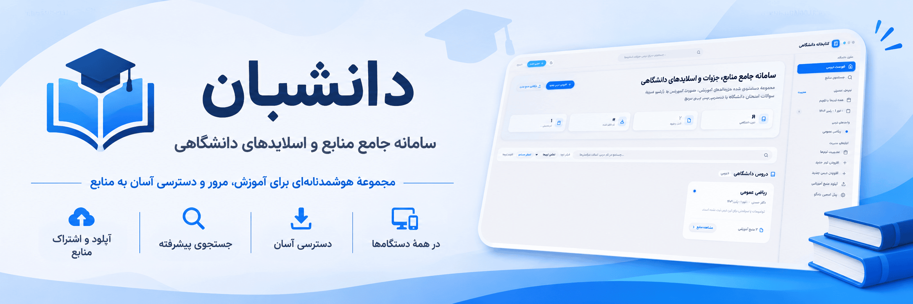

# سامانه مدیریت کتابخانه و منابع دانشگاهی (Daneshban)

سامانه تحت وب بر پایه فریم‌ورک پایتون و جنگو (Django) برای مدیریت، دسته‌بندی و دسترسی آسان به جزوه‌ها، اسلایدها، صورت تمرین‌ها، نمونه سوالات امتحانی و مراجع درسی دانشگاه. این پروژه به‌صورت کاملاً راست‌به‌چپ (RTL)، با فونت وزیرمتن (Vazirmatn) به‌صورت خودمیزبان (Self-hosted) و برون‌خط (Offline)، همراه با تاریخ شمسی و ارقام فارسی طراحی شده است.

---

### فهرست مطالب
1. [ویژگی‌های کلیدی](#ویژگیهای-کلیدی)
2. [پیش‌نیازها](#پیشنیازها)
3. [نصب و اجرا با Docker (روش پیشنهادی)](#نصب-و-اجرا-با-docker-روش-پیشنهادی)
4. [توسعه محلی (Clone و اجرا از سورس)](#توسعه-محلی-clone-و-اجرا-از-سورس)
5. [ایجاد حساب مدیر (Superuser)](#ایجاد-حساب-مدیر-superuser)
6. [ایجاد داده‌های نمونه (Seed Demo)](#ایجاد-دادههای-نمونه-seed-demo)
7. [نحوه افزودن دروس و فایل‌ها](#نحوه-افزودن-دروس-و-فایلها)
8. [تغییر فونت سامانه](#تغییر-فونت-سامانه)
9. [پشتیبان‌گیری از پایگاه داده و فایل‌ها (Backup)](#پشتیبانگیری-از-پایگاه-داده-و-فایلها-backup)
10. [نکات استقرار در محیط عملیاتی (Production Deployment)](#نکات-استقرار-در-محیط-عملیاتی-production-deployment)
11. [اجرای آزمون‌ها (Tests)](#اجرای-آزمونها-tests)

---

### ویژگی‌های کلیدی
- **کاملاً فارسی و راست‌به‌چپ (RTL):** طراحی شده با رعایت ویژگی‌های منطقی مدرن CSS (`margin-inline`، `padding-inline` و ...) بدون وابستگی به CDN خارجی.
- **فونت وزیرمتن خودمیزبان:** فایل‌های رسمی woff2 درون پوشه `static/fonts/` قرار گرفته و سامانه ۱۰۰٪ به‌صورت آفلاین کار می‌کند.
- **تقویم شمسی (جلالی):** تمامی تاریخ‌های بارگذاری با ماژول `jdatetime` به شمسی تبدیل و با ارقام فارسی (۰۱۲۳۴۵۶۷۸۹) نمایش داده می‌شوند.
- **دسته‌بندی خودکار بر اساس نوع فایل:** جزوه‌ها، اسلایدها، تمرین‌ها، نمونه سوال‌ها، کتاب‌ها و سایر منابع.
- **جستجوی پیشرفته و فیلتر ترم:** جستجو در عنوان فایل، نام درس، نام استاد، سرفصل‌ها و برچسب‌ها.
- **دانلود استاندارد با نام‌های فارسی:** پشتیبانی کامل از استاندارد RFC 5987 (`filename*=UTF-8''...`).
- **اعتبارسنجی آپلود:** محدودیت حجم (پیش‌فرض ۱۰۰ مگابایت) و کنترل پسوندهای مجاز (PDF، Office، فشرده، تصاویر و متن).
- **پنل مدیریت جنگو:** کاملاً فارسی و راست‌به‌چپ برای مدیریت جزئی‌ترین بخش‌های سامانه.
- **پشتیبانی از Docker:** ایمیج‌های از پیش ساخته شده در GitHub Container Registry.

---

### پیش‌نیازها
- **برای Docker:** Docker Engine 24+ و Docker Compose v2+
- **برای توسعه محلی:** پایتون ۳.۱۱+، `python3-venv`

---

### نصب و اجرا با Docker (روش پیشنهادی)

این روش از ایمیج‌های از پیش ساخته شده در **GitHub Container Registry** استفاده می‌کند و نیاز به کلون کردن پروژه یا ساخت ایمیج محلی ندارد.

#### ۱. پیش‌نیازها
```bash
# Docker و Docker Compose نصب باشند
docker --version
docker compose version
```

#### ۲. دریافت فایل‌های پیکربندی
```bash
# فایل محیطی نمونه و docker-compose را دریافت کنید
curl -O https://raw.githubusercontent.com/amirrezesf/Daneshban/main/.env.example
curl -O https://raw.githubusercontent.com/amirrezesf/Daneshban/main/docker-compose.yml

# فایل .env را ویرایش کنید
mv .env.example .env
# SECRET_KEY، ALLOWED_HOSTS و سایر متغیرها را در .env تنظیم کنید
```

#### ۳. اجرای با Docker Compose (پیشنهادی)
```bash
# شروع سرویس‌ها (ایمیج از ghcr.io دریافت می‌شود)
docker compose up -d
```

#### ۴. اجرای کانتینر مستقل (بدون docker-compose)
```bash
# دریافت آخرین ایمیج
docker pull ghcr.io/amirrezesf/daneshban:latest

# اجرا
docker run -d \
  --name daneshban \
  -p 2445:2445 \
  -e SECRET_KEY="your-secret-key" \
  -e DEBUG=False \
  -e ALLOWED_HOSTS="*" \
  -v $(pwd)/media:/app/media \
  -v $(pwd)/staticfiles:/app/staticfiles \
  ghcr.io/amirrezesf/daneshban:latest
```

#### ۵. دسترسی به سامانه
مرورگر را باز کرده و به آدرس `http://localhost:2445` مراجعه کنید.

> **نکته:** برای Production حتماً متغیرهای محیطی را در فایل `.env` تنظیم کنید و از `DEBUG=False` استفاده کنید. SECRET_KEY را با یک مقدار تصادفی و امن پر کنید.

---

### توسعه محلی (Clone و اجرا از سورس)

این روش برای مشارکت در توسعه یا سفارشی‌سازی کد مناسب است.

```bash
# 1. کلون مخزن
git clone https://github.com/amirrezesf/Daneshban.git
cd Daneshban

# 2. ایجاد محیط مجازی
python3 -m venv .venv
source .venv/bin/activate

# 3. نصب وابستگی‌ها
pip install -r requirements.txt

# 4. تنظیم متغیرهای محیطی
cp .env.example .env
# فایل .env را ویرایش کنید

# 5. اعمال مایگریشن‌ها
python manage.py migrate

# 6. اجرای سرور توسعه
python manage.py runserver
```

سامانه در آدرس `http://127.0.0.1:8000/` در دسترس خواهد بود.

---

### ایجاد حساب مدیر (Superuser)

برای دسترسی به پنل مدیریت، امکان آپلود، ویرایش و حذف دروس:

**توسعه محلی:**
```bash
source .venv/bin/activate
python manage.py createsuperuser
```

**با Docker:**
```bash
docker exec -it daneshban python manage.py createsuperuser
```

سپس نام کاربری، ایمیل و گذرواژه دلخواه خود را وارد نمایید. پس از ورود با این حساب، دکمه‌های «درس جدید»، «آپلود منبع»، «ویرایش» و «حذف» در تمامی صفحات فعال خواهند شد.

همچنین پنل ادمین جنگو در آدرس زیر در دسترس است:
`http://127.0.0.1:8000/admin/`

---

### ایجاد داده‌های نمونه (Seed Demo)

برای مشاهده سریع عملکرد سامانه به همراه دروس و فایل‌های نمونه:

**توسعه محلی:**
```bash
source .venv/bin/activate
python manage.py seed_demo
```

**با Docker:**
```bash
docker exec -it daneshban python manage.py seed_demo
```

این دستور موارد زیر را به طور خودکار ایجاد می‌کند:
- کاربر مدیر با نام کاربری `admin` و رمز عبور `admin123`
- ۳ ترم تحصیلی (پاییز ۱۴۰۳، بهار ۱۴۰۴، پاییز ۱۴۰۴)
- ۳ درس (ریاضی عمومی ۱، مبانی کامپیوتر و برنامه‌نویسی، مدارهای منطقی)
- ۱۱ منبع آموزشی نمونه شامل جزوه دست‌نویس، اسلاید، صورت تمرین، پروژه فشرده، و نمونه سوالات با پاسخ.

برای پاک‌سازی و ایجاد مجدد داده‌های نمونه:
```bash
python manage.py seed_demo --clear
```

---

### نحوه افزودن دروس و فایل‌ها

#### ۱. افزودن درس جدید:
- وارد سامانه شوید («ورود مسئول» در هدر صفحه).
- روی دکمه «درس جدید» کلیک کنید.
- عنوان درس (الزامی)، استاد، ترم تحصیلی، رنگ شاخص کارت درس و توضیحات را وارد نموده و «ثبت درس جدید» را بزنید.
- شناسه یکتای پیوند (اسلاگ فارسی) به‌طور خودکار از عنوان درس تولید می‌شود.

#### ۲. بارگذاری منابع (جزوه‌ها و اسلایدها):
- وارد صفحه درس مورد نظر شده و روی «آپلود فایل جدید» کلیک کنید (یا از دکمه «آپلود منبع» در نوار بالای سایت استفاده کنید).
- عنوان منبع، نوع منبع (جزوه، اسلاید، تمرین، نمونه سوال، کتاب یا سایر)، شماره جلسه (اختیاری) و فایل مورد نظر را انتخاب نمایید.
- حجم فایل به‌طور خودکار محاسبه و ذخیره می‌گردد.

---

### تغییر فونت سامانه

فونت پیش‌فرض سامانه، فونت آزاد و استاندارد **وزیرمتن (Vazirmatn)** در سه وزن ۴۰۰ (معمولی)، ۵۰۰ (متوسط) و ۷۰۰ (بولد) است که درون پوشه زیر قرار دارد:
`static/fonts/`

در صورت تمایل به تعویض فونت (مثلاً به ساحل، شبنم، صمیم یا ایران‌سنس):
۱. فایل‌های فونت جدید در قالب `.woff2` را درون پوشه `static/fonts/` کپی کنید.
۲. در ابتدای فایل `static/css/app.css`، دستورات `@font-face` را با نام فایل‌های جدید به‌روزرسانی کنید:
```css
@font-face {
  font-family: 'MyFont';
  src: url('/static/fonts/MyFont-Regular.woff2') format('woff2');
  font-weight: 400;
  font-display: swap;
}
```
۳. مقدار متغیر `--font-sans` را در ریشه CSS تغییر دهید:
```css
:root {
  --font-sans: 'MyFont', Tahoma, sans-serif;
}
```

---

### پشتیبان‌گیری از پایگاه داده و فایل‌ها (Backup)

کل اطلاعات سامانه درون دو بخش ذخیره می‌شود:
۱. **پایگاه داده SQLite:** فایل `db.sqlite3` در ریشه پروژه.
۲. **فایل‌های بارگذاری شده:** پوشه `media/` در ریشه پروژه.

برای تهیه نسخه پشتیبان کافیست این دو مورد را آرشیو کنید:

```bash
cd ~/Documents/UniversityLibrary
tar -czvf university_library_backup_$(date +%Y%m%d).tar.gz db.sqlite3 media/
```

برای بازیابی (Restore) کافیست فایل فشرده بکاپ را استخراج نمایید:
```bash
tar -xzvf university_library_backup_YYYYMMDD.tar.gz
```

**با Docker (Volume-based backup):**
```bash
# Backup volumes
docker run --rm \
  -v daneshban_media:/media \
  -v daneshban_staticfiles:/staticfiles \
  -v $(pwd)/backups:/backup \
  alpine tar -czvf /backup/backup_$(date +%Y%m%d).tar.gz /media /staticfiles
```

---

### نکات استقرار در محیط عملیاتی (Production Deployment)

۱. **تنظیمات متغیرهای محیطی:**
فایل `.env` را در ریشه پروژه بسازید و مقادیر امنیتی را مقداردهی کنید:
```env
SECRET_KEY=your-secure-random-secret-key-here
DEBUG=False
ALLOWED_HOSTS=yourdomain.com,www.yourdomain.com
MAX_UPLOAD_SIZE_MB=100
```

۲. **جمع‌آوری فایل‌های استاتیک:**
```bash
python manage.py collectstatic --noinput
```

**با Docker (در ایمیج انجام شده است):**
```bash
docker exec -it daneshban python manage.py collectstatic --noinput
```

۳. **سرو فایل‌های Media و Static توسط وب‌سرور (مانند Nginx):**
در محیط عملیاتی نباید فایل‌های آپلودی مستقیماً توسط وب‌سرور داخلی جنگو سرو شوند. نمونه پیکربندی Nginx:
```nginx
server {
    listen 80;
    server_name yourdomain.com;
    client_max_body_size 100M;

    location /static/ {
        alias /path/to/UniversityLibrary/staticfiles/;
    }

    location /media/ {
        alias /path/to/UniversityLibrary/media/;
    }

    location / {
        proxy_pass http://127.0.0.1:2445;
        proxy_set_header Host $host;
        proxy_set_header X-Real-IP $remote_addr;
        proxy_set_header X-Forwarded-For $proxy_add_x_forwarded_for;
        proxy_set_header X-Forwarded-Proto $scheme;
    }
}
```

۴. **اجرا توسط Gunicorn:**
```bash
gunicorn config.wsgi:application --bind 127.0.0.1:2445 --workers 3
```

**در Docker:** از Gunicorn به‌عنوان پیش‌فرض استفاده شده (`CMD` در Dockerfile).

۵. **HTTPS و SSL:** از Let's Encrypt / Certbot برای صدور گواهی SSL استفاده کنید.
۶. **پایگاه داده Production:** برای بار بالا، از PostgreSQL به‌جای SQLite استفاده کنید (متغیر `DATABASE_URL` را تنظیم کنید).

---

### اجرای آزمون‌ها (Tests)

برای اجرای تمامی آزمون‌های خودکار سامانه (تست مدل‌ها، اسلاگ فارسی، اعتبارسنجی آپلود، ویوها، دانلود با RFC 5987، فیلترهای جلالی و راست‌به‌چپ):

**توسعه محلی:**
```bash
source .venv/bin/activate
python manage.py test
```

**با Docker:**
```bash
docker exec -it daneshban python manage.py test
```

تمامی تست‌ها با موفقیت عبور می‌کنند.

---

## 📦 Release & CI/CD

این پروژه از GitHub Actions برای CI/CD استفاده می‌کند:

- **`.github/workflows/docker-ci.yml`** — در هر push/PR اجرا می‌شود: چک‌های سیستمی جنگو، ساخت و تست Docker
- **`.github/workflows/release.yml`** — در تگ‌های نسخه (`v*`) فعال می‌شود: تولید changelog از conventional commits، ایجاد GitHub Release، ساخت و_push_ ایمیج Docker به `ghcr.io`

### قرارداد کامیت (برای changelog)
از [Conventional Commits](https://www.conventionalcommits.org/) استفاده کنید:
```
feat: add new search filters
fix: resolve upload validation bug
docs: update README with Docker instructions
chore: update dependencies
refactor: simplify view logic
perf: optimize database queries
security: fix XSS vulnerability
breaking: change API response format
```

Workflowِ انتشار به‌طور خودکار کامیت‌ها را دسته‌بندی می‌کند:
- 🚀 Features
- 🐛 Bug Fixes
- 📝 Documentation
- 🔧 Maintenance
- ⚡ Performance
- 🔒 Security
- 💥 Breaking Changes

### برچسب‌های ایمیج Docker
- `ghcr.io/amirrezesf/daneshban:v1.2.3` — نسخه مشخص
- `ghcr.io/amirrezesf/daneshban:v1.2` — major.minor
- `ghcr.io/amirrezesf/daneshban:latest` — آخرین شاخه main

---

## 📄 License

MIT License — see [LICENSE](LICENSE) for details.